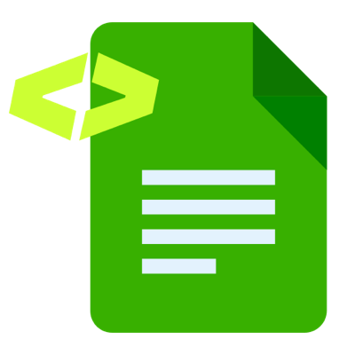

<p align="center">
  
</p>

<h1 align="center">DocuWriter.ai MCP server</h1>

<p align="center">
  Connect your AI tools to <a href="https://www.docuwriter.ai">DocuWriter.ai</a> — generate, search, and manage codebase documentation without leaving your editor.
</p>

---

This is the official **remote MCP server** for [DocuWriter.ai](https://www.docuwriter.ai). It is hosted — there is nothing to clone, build, or run locally. You point your MCP-compatible client at the server URL, authenticate once with your DocuWriter.ai account, and its tools become available to your AI assistant.

- **Endpoint:** `https://app.docuwriter.ai/mcp`
- **Transport:** Streamable HTTP
- **Auth:** OAuth 2.1 (handled automatically by your client on first connect)
- **Registry:** [`ai.docuwriter/docuwriter`](https://registry.modelcontextprotocol.io/v0.1/servers?search=ai.docuwriter%2Fdocuwriter) in the official MCP Registry

A [DocuWriter.ai account](https://www.docuwriter.ai) is required (free trial available).

## What you can do

The server exposes 77 tools covering the DocuWriter.ai platform:

- **Generate documentation** from source code — code docs, README files, UML diagrams, Swagger/OpenAPI specs, code comments, tests, and language conversion.
- **Full documentation trees** — generate and manage complete documentation trees for an imported repository.
- **Repository documentation reviews** — inspect affected pages and maximum credits, explicitly approve one paid review, check its progress, and open the browser to review changes.
- **Semantic search** over your docs and spaces.
- **Autopilot** — review, apply, snooze, or discard the documentation suggestions Autopilot generates on repository changes.
- **Spaces & documents** — create, update, move, copy, and export spaces, documents, folders, and share links.
- **Repositories** — manage provider connections (GitHub, GitLab, Bitbucket, Azure) and Autopilot repository links.
- **Teams & webhooks** — manage teammates, invitations, roles, and webhook subscriptions.

## Review documentation against repository changes

Ask your assistant: “Check whether this Space’s documentation needs updating from its repository. Show the affected pages and maximum credits before starting.”

1. Resolve the intended numeric `space_id` with `list-spaces`. The current page or local repository name does not grant permission to write.
2. Call `inspect-documentation-update` with that Space and optional selected page IDs. Inspection can read the connected provider, but never invokes models, queues work, or reserves credits. It returns eligibility, branch, baseline/target commits, affected pages, available credits, maximum credits, and a review quote.
3. Show the Space, branch, page scope/reason, and maximum credit cost. Call `start-documentation-update` with that returned quote only after the user explicitly authorizes the paid review. The quote expires after 30 minutes; changed scope, source, content, payer, or price requires inspection and approval again. A quote or tool annotation alone is not human consent.
4. Call `get-documentation-update-status` for persisted progress, pending-change counts, credit usage, and the existing browser review URL. Say “review queued/running” when appropriate; documentation has not yet been updated.
5. Open the returned browser review URL to inspect diffs and apply or reject changes. New-page approval, resuming, and ending reviews remain browser actions. Paused or failed reviews are not automatically retried.

Page selection is supported for first/full reviews. Omitting it selects all reviewable pages; diff reviews reject page selection. Reusing the same accepted quote returns the same run, including after completion or failure; it does not buy another attempt. A different active review returns a conflict with its browser link.

Use `update-space-document` for an editorial change to an existing page, Autopilot link/suggestion tools for automatic sync, and generators for new documentation. A vague “update docs” request needs clarification about the intended change.

## Connect your client

### Claude Code

```bash
claude mcp add --transport http docuwriter https://app.docuwriter.ai/mcp
```

Or install the [DocuWriter.ai plugin for Claude](https://github.com/DocuWriter-ai/claude-plugin), which bundles this server with DocuWriter skills and also works in Claude chat and Cowork. Use one method or the other, not both, so Claude doesn't load the server twice.

### Cursor

Add to `~/.cursor/mcp.json` (global) or `.cursor/mcp.json` (project):

```json
{
  "mcpServers": {
    "docuwriter": {
      "url": "https://app.docuwriter.ai/mcp"
    }
  }
}
```

### VS Code

Add to `.vscode/mcp.json`:

```json
{
  "servers": {
    "docuwriter": {
      "type": "http",
      "url": "https://app.docuwriter.ai/mcp"
    }
  }
}
```

### Claude Desktop

Settings → **Connectors** → **Add custom connector** → enter the URL `https://app.docuwriter.ai/mcp`.

### Codex CLI

Codex configures MCP servers in `~/.codex/config.toml`. Because this server uses interactive OAuth, connect through the [`mcp-remote`](https://www.npmjs.com/package/mcp-remote) bridge, which opens the browser sign-in flow and speaks stdio to Codex:

```toml
[mcp_servers.docuwriter]
command = "npx"
args = ["-y", "mcp-remote", "https://app.docuwriter.ai/mcp"]
```

Recent Codex versions can also connect directly to a streamable HTTP server:

```toml
[mcp_servers.docuwriter]
url = "https://app.docuwriter.ai/mcp"
```

If the direct form cannot complete the OAuth sign-in, use the `mcp-remote` form above.

### Cline

See [`llms-install.md`](./llms-install.md) — Cline can configure this server automatically.

## Authentication

On first connect, your client opens a browser window to sign in to DocuWriter.ai and authorize access (OAuth 2.1). No API keys to copy or store. Tokens are managed by your client.

## Links

- Website — https://www.docuwriter.ai
- Documentation — https://docs.docuwriter.ai
- Claude plugin — https://github.com/DocuWriter-ai/claude-plugin
- Support — support@docuwriter.ai
- Privacy — https://app.docuwriter.ai/privacy-policy

## License

The contents of this repository (documentation and connection metadata) are released under the [MIT License](./LICENSE). The DocuWriter.ai service and MCP server itself are proprietary and operated by DocuWriter.ai.
